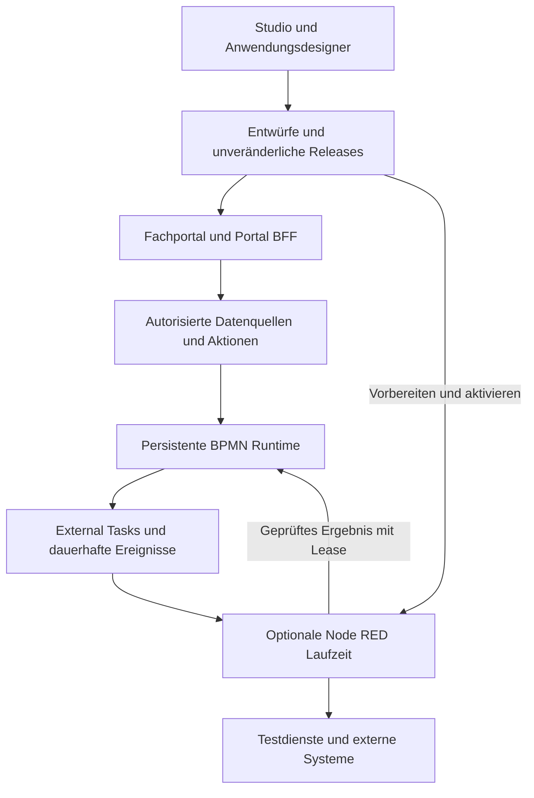

# Implementierungsplan für die VertexBPMN Low Code Anwendungsplattform

Stand: 2026-10-13. Planungsbasis: `2e772249c448292edefda4c3136cea386c8bef7b` auf `master`.

Status: **Plan erstellt. Die hier beschriebenen Erweiterungen sind nicht begonnen.**

Planergänzung vom 2026-10-13: Für Entwicklung und manuelle Prüfung aller in diesem Plan neu eingeführten oder geänderten HTTP-Endpunkte werden ausführbare `.http`-Dateien als verbindliches Lieferartefakt ergänzt. Die Umsetzung folgt dem vorhandenen ASP.NET-Web-API-Projekt und dem integrierten HTTP-Editor von Visual Studio.

VertexBPMN soll zusätzlich zur Prozessmodellierung die Erstellung von Fachanwendungen ermöglichen: Daten abrufen und zuordnen, eigene Seiten zusammenstellen, Aufgaben bearbeiten, technische Integrationen visuell programmieren und die zusammengehörigen Artefakte gemeinsam veröffentlichen. Die vorhandene persistente BPMN-Runtime bleibt verantwortlich für Geschäftsprozesse, Aufgaben und deren Fortsetzung.

Die empfohlene Architektur besteht aus einem konfigurierbaren .NET-Fachportal und einer optional betriebenen Node-RED-Laufzeit für technische Flows. Zuerst werden die bestehenden Connector- und Formularpfade geschlossen. Anschließend folgen Anwendungsdefinitionen, Portal, Designer, Flow-Anbindung und gemeinsame Releases. Eine eigene allgemeine Flow-Engine gehört nicht zum ersten Ausbau.

Dieser Plan ist ein eigenständiger Arbeitsauftrag für eine spätere Umsetzung. Neue Typen, Projekte, Routen, Optionen und Testkategorien sind ausdrücklich **Vorschläge**, solange sie nicht als bestehend bezeichnet werden. Die aktuelle Beauftragung umfasst die Planung; sie startet keine Implementierung, Migration, Installation oder Veröffentlichung. Git-Aktionen und externe Deployments folgen der jeweiligen Nutzerautorisierung und `AGENTS.md`.

## 1 Ziel und Lieferumfang

### 1.1 Referenzanwendung

Als durchgehender Abnahmefall dient eine Rechnungsfreigabe mit zwei isolierten Mandanten:

1. Eine Fachperson öffnet ihre Anwendung und sucht einen Kunden in einer paginierten Tabelle.
2. Eine Datenquelle liest Kundendaten aus einer lokalen Test-API; Antwortfelder werden im Designer einem Formular zugeordnet.
3. Die Person erfasst eine Rechnung. Die serverseitig validierte Aktion startet genau die Prozessdefinition des ausgewählten Anwendungsreleases.
4. Eine DMN-Entscheidung bestimmt den Freigabeweg. Eine Benutzeraufgabe zeigt das zum Release gehörende Formular mit vorbelegten Daten.
5. Die berechtigte Person übernimmt und erledigt die Aufgabe. Der Prozess setzt sich persistent fort.
6. Ein technischer Node-RED-Flow verarbeitet einen External Task, ruft einen idempotenten Testdienst auf und meldet ein geprüftes Ergebnis zurück.
7. Das Portal zeigt den Prozesszustand und das Ergebnis. Ein Neustart zwischen Verarbeitung und Completion verliert weder den Auftrag noch seine Versionsbindung.
8. Release 2 verändert Formular und Integration. Neue Instanzen verwenden Release 2; laufende Instanzen behalten Release 1. Ein Rollback ändert die Auswahl für neue Vorgänge, ohne laufende Instanzen umzubinden.

Die Anwendung entsteht mit bereitgestellten Bausteinen und Konfiguration. Neuer C#- oder JavaScript-Code ist für diesen Referenzfall nicht erforderlich; die erstmalige Bereitstellung der Bausteine ist Entwicklerarbeit.

### 1.2 Lieferstufen

| Stufe | Ergebnis | Pflichtpakete |
| --- | --- | --- |
| A | Verlässlich ausführbare Connectoren, Datenzuordnung und versionierte Aufgabenformulare im bestehenden Studio | LC00 bis LC04 |
| B | Erste veröffentlichbare Fachanwendung mit Portal, Tabellen, Formularen, Aktionen und gemeinsamen Releases | LC05 bis LC07, LC10 und B-Abnahme aus LC12 |
| C | Visuell programmierte technische Flows, dauerhafte Ereignisanbindung und eigene Anwendungsendpunkte | LC08 bis LC10 und C-Abnahme aus LC12 |
| D | Installierbares Portal und begrenzte, ausdrücklich aktivierte Offline-Aufgabenbearbeitung | LC11 und D-Abnahme aus LC12 |

Alle Stufen gehören zum Gesamtplan. Die Node-RED-Funktion bleibt im Betrieb optional: Stufe B und bestehende Vertex-Installationen müssen ohne Node.js, Node-RED, Docker oder Cloud-Zugang funktionieren. Eine fertige Stufe darf separat ausgeliefert werden; daraus folgt kein Abschluss späterer Stufen.

## 2 Ausgangslage und vorhandene Anschlussstellen

| Aktueller Befund | Bestehende Dateien | Konsequenz |
| --- | --- | --- |
| Der Low-Code-Katalog und seine Muster erzeugen direkt BPMN | `src/VertexBPMN.Studio/Components/Pages/BpmnModelerPage.razor`, `src/VertexBPMN.Studio/wwwroot/js/bpmn-modeler.js` | Geschäftsprozessmodell erhalten; technische Flows als getrenntes Artefakt ergänzen |
| Template-Felder für HTTP-Methode und Endpoint landen in `vertex:ioMapping`; der Handler liest `vertex:connector.*` | `bpmn-modeler.js`, `src/VertexBPMN.Engine/Parsing/VertexBpmnExtensions.cs`, `src/VertexBPMN.Application/Connectors/VertexConnectorServiceTaskHandler.cs` | LC02 schließt den vollständigen Studio-zu-Runtime-Vertrag |
| Der HTTP-Executor liefert Status, aber keinen Antwortinhalt; der DB-Executor führt `ExecuteNonQueryAsync` aus | `src/VertexBPMN.Application/Connectors/HttpConnectorExecutor.cs`, `DatabaseConnectorExecutor.cs` | Begrenzte Datenantworten und getrennte Leseoperationen ergänzen |
| IO-Mappings sind als textuelle `name=value`-Einträge bearbeitbar | `src/VertexBPMN.Studio/tools/bpmn-io/src/vertex-properties-provider.js` | Typisierte Zuordnung, Vorschau und Diagnose ergänzen |
| OpenAPI- und n8n-Import sind vorhanden | `src/VertexBPMN.Application/Import/OpenApiConnectorTemplateImporter.cs`, `N8nWorkflowImporter.cs` | Teilumfang erhalten und tatsächliche ausführbare Bindungen prüfen; keine vollständige Fremdruntime-Kompatibilität behaupten |
| Formulare sind tenantbezogen gespeichert; Updates überschreiben die Zeile und erhöhen `Version` | `src/VertexBPMN.Domain/Entities/FormDefinitionRecord.cs`, `src/VertexBPMN.Infrastructure/Persistence/Services/PersistentFormDefinitionService.cs` | Unveränderliche Formularrevisionen mit Upgradepfad einführen |
| User Tasks übernehmen das aktuelle Schema anhand des Form-Keys; `formVersion` steuert diese Auswahl nicht | `src/VertexBPMN.Engine/Execution/PersistentProcessExecutionRuntime.cs`, Methode `CreateUserTaskWaitAsync` | Explizite Formularbindung und Task-Snapshot sichern |
| Der Aufgaben-Dialog kann eine lokale JSON-Datei vor dem gespeicherten Task-Schema verwenden; die Listenaktion erledigt Aufgaben ohne Formular | `src/VertexBPMN.Studio/Components/TaskDetailsDialog.razor`, `Components/Pages/Tasks.razor` | Snapshot hat Vorrang; formulargebundene Aufgaben durchlaufen denselben validierten Abschluss |
| Externe Aufgaben haben Claim, Heartbeat, Completion, Fail und Fencing | `src/VertexBPMN.Api/Controllers/ExternalTaskController.cs`, `src/VertexBPMN.Infrastructure/Persistence/ExternalTaskLeaseService.cs` | Diesen Vertrag für Node-RED wiederverwenden |
| Der konfigurierte External-Task-Vertragsresolver akzeptiert begrenzte skalare Inputs, keine allgemeinen Objekt-/Array-Inputs | `src/VertexBPMN.Infrastructure/Persistence/ConfiguredExternalTaskContractResolver.cs` | Versionierten, begrenzten JSON-Vertrag ergänzen; bisherige Regeln nicht stillschweigend erweitern |
| Das Studio verwendet Blazor Interactive Server | `src/VertexBPMN.Studio/Components/App.razor`, `Program.cs` | Fachportal mit eigenem Client-Lebenszyklus und PWA-Fähigkeit planen |
| Ein verschlüsselter persistenter OIDC-Session-Store existiert; lokale Registrierung kann einen In-Memory-Store wählen | `src/VertexBPMN.Studio/Services/PersistentOidcSessionStore.cs`, `OidcSessionStoreProvider.cs`, `Program.cs` | Vorhandene Authentifizierung prüfen und wiederverwenden; verteilte Portal-Sitzungen separat abnehmen |
| Source Control besitzt Deploy-Befehle und Provenienz; der Git-Plan enthält G10 für weitere Artefakte und Manifeste | `src/VertexBPMN.SourceControl.Abstractions/DeploymentCommand.cs`, `DeploymentProvenance.cs`, Git-Implementierungsplan | Gemeinsames Release-Manifest abstimmen; kein zweites konkurrierendes Git-System |
| Editor-Bundles haben eine reproduzierbare Buildpipeline | `src/VertexBPMN.Studio/package.json`, `VertexBPMN.Studio.csproj`, `tools/bpmn-io/` | Quellen ändern und Bundles über vorhandene Targets bauen |
| Das API-Projekt enthält eine `.http`-Datei mit einem Weatherforecast-Template, aber keinen Low-Code-Requestkatalog | `src/VertexBPMN.Api/VertexBPMN.Api.http`, `Properties/launchSettings.json` | Vorhandenen Einstieg auf tatsächliche API-Routen ausrichten und thematische Requestdateien ergänzen |

Der Template-Befund wurde am 2026-10-13 durch Ausführen der bestehenden JavaScript-Erzeugungsfunktion und Serialisieren mit dem tatsächlichen Vertex-Moddle reproduziert. Der daraus erwartete API-Ausführungsfehler wurde nicht gegen einen laufenden API-Host reproduziert. LC00 und LC02 enthalten diesen Nachweis als Pflichtprüfung.

Die bereits ausgeführten neun Editor-Validierungsfälle und der Vertex-Moddle-Roundtrip waren erfolgreich. Das ist eine Ausgangsevidenz für Editorregeln und XML-Erhalt, keine Abnahme der neuen Anwendungsplattform.

### 2.1 Verhältnis zu bestehenden Plänen

- [Älterer Low-Code-Auftrag](Codex-Auftrag_VertexBPMN%20Low-Code%20Studio.md): vorhandene Leistungen inventarisieren und wiederverwenden. Seine historische Lückenliste ist kein aktueller Status. Für die hier geplante Erweiterung gelten die Testgrenzen aus `AGENTS.md` und CI; kein ungefilterter Gesamtlauf mit externen Voraussetzungen als schnelles Gate.
- [Studio-Workspace-Plan](2026-09-09_Studio-Modellierungsworkspace_Implementierungsplan.md): Entwurfsspeicherung, Revisionen, Kontextwechsel und Undo/Redo übernehmen, soweit tatsächlich implementiert. Fehlende Pflichtbausteine als LC05/LC07-Arbeit erfassen.
- [Git-Plan](2026-10-05_Git-Modellversionierung_Implementierungsplan.md): G10 und LC10 teilen das Artefaktmanifest; Commit, Push, Review und Aktivierung bleiben getrennte Vorgänge.
- [Azure-Plan](2026-09-17_Azure-Deployment-und-Service-Bus-Umsetzungsplan.md) und [Produktions-Runbook](../runbooks/production-deployment.md): bestehende Provider, Outbox, Migrationseintritt und Rolloutregeln erhalten. Cloud-Provisionierung ist keine Voraussetzung dieses Plans.

## 3 Zielarchitektur

### 3.1 Verantwortlichkeiten

| Baustein | Verantwortung | Umsetzungsvorschlag |
| --- | --- | --- |
| Studio | Prozesse, Formulare, Datenquellen, Seiten und Releases entwerfen | Bestehende Blazor-Oberfläche um Designer ergänzen |
| Anwendungsdienste | Definitionen prüfen, Datenzugriff autorisieren, Aktionen ausführen, Releases aktivieren | Neue Module unter `VertexBPMN.Application`, Persistenz unter `VertexBPMN.Infrastructure`, geschützte API |
| Fachportal | Veröffentlichte Seiten aus Metadaten rendern; persönliche Aufgaben bearbeiten | Neue Projekte `VertexBPMN.Portal` als ASP.NET-Core-Host und `VertexBPMN.Portal.Client` als Blazor-WebAssembly-Client |
| Portal-BFF | Serverseitiger Ansprechpartner des Browsers für Anmeldung, Cookies, Tokenhaltung und autorisierte API-Aufrufe | Bestehende OIDC-Bausteine nach LC01-Prüfung in eine kleine gemeinsame Authentifizierungsbibliothek überführen |
| BPMN-Runtime | Persistente Geschäftsabläufe, Definitionen, Aufgaben, Timer und Fortsetzungen | Vorhandene Engine und öffentliche Verträge |
| Node-RED-Adapter | Technische Flows, Vertex-Nodes, External-Task-Verarbeitung | Vorgeschlagenes Paket unter `integrations/node-red/vertex-nodes/`; eigene Node.js-Laufzeit |
| Release-Orchestrierung | Unveränderliche Artefakte vorbereiten, aktivieren und wiederherstellen | Gemeinsame Orchestrierung mit Referenzen auf bestehende Deployments und Git-Provenienz |

Die zusätzlichen Portal-Projekte ermöglichen einen vom Studio getrennten Fachnutzerablauf und Offline-Unterstützung. Sie erzeugen keine zweite Engine. LC01 bestätigt diese Projektgrenzen und den minimal nötigen gemeinsamen Authentifizierungscode vor dessen Herauslösung.



### 3.2 Verbindliche Grenzen

1. **Eine Quelle für den Geschäftsprozesszustand:** Node-RED-Context und Browserzustand ersetzen keine Engine-Instanzen, Inbox, Outbox oder Tasks. Kritische Arbeit läuft über External Tasks und dauerhafte Fortsetzungen.
2. **Mandant und Identität serverseitig bestimmen:** Queryparameter, Flow-Messages und Release-Manifeste sind keine Autorisierungsnachweise. Fremde Referenzen werden vor Datenzugriff und Secret-Auflösung verworfen. Hintergrundworker und handelnde Benutzer sind unterschiedliche Identitäten.
3. **Keine Tokens im Browserzustand:** Portal verwendet serverseitig verwaltete Tokens und geschützte Cookies; Cookie-Mutationen besitzen CSRF-Schutz. OIDC/JWT bleiben Standardbibliotheken und bestehende Authority-/Keycloak-Verträge.
4. **Node-RED ist keine Sandbox:** pro Mandant bzw. nachgewiesen gleichberechtigtem Vertrauensbereich eine getrennte Laufzeit mit eigener Workeridentität, begrenztem Netz-/Dateizugriff und Ressourcenlimits. Keine gemeinsam privilegierte Laufzeit für fremde Mandanten. Editorrechte und Laufzeitrechte sind getrennt.
5. **Versionen sind explizit:** veröffentlichte Artefakte, Prozessdefinitionen, Formularrevisionen, technische Flows und Task-Verträge werden anhand unveränderlicher IDs und Hashes gebunden. Neue Releases ändern keine laufenden Vorgänge automatisch.
6. **Externe Wirkungen brauchen fachliche Idempotenz:** Completion/Fencing verhindert nicht allein doppelte E-Mails, Buchungen oder HTTP-Wirkungen. Pro externer Aktion einen stabilen fachlichen Schlüssel und eine dokumentierte Wiederholungsstrategie festlegen.
7. **Begrenzte Ausführung:** Aufrufe haben Cancellation, Timeout, Größen-/Zeilen-/Parallelitätslimits und nachvollziehbare Fehler. Visualisierung übernimmt keine ungeprüften Response-Bodies, HTML-Fragmente oder Scripttexte.
8. **Bestehende Profile erhalten:** SQLite lokal und vorhandene Serverprovider beibehalten. Neue Infrastrukturtests laufen explizit und isoliert; Node-RED optional per vorhandenem lokalen Dienst oder getrenntem Prozess, zusätzlich WSLC-/Containerprofil.
9. **Module ausgeschaltet bleibt kompatibel:** keine neuen Pflichtdienste beim normalen API-/Studio-Start. Neue Konfigurationsschalter werden erst mit Optionsbinding, Startvalidierung, Dokumentation und Tests als verfügbar bezeichnet.

## 4 Daten und öffentliche Verträge

### 4.1 Vorgeschlagene Artefakte

| Artefakt | Inhalt und Bindung |
| --- | --- |
| `ApplicationDefinition` und `ApplicationRevision` | Tenant, stabiler Schlüssel, unveränderliche Seiten-/Aktionsdefinition, Schema-Version, Revision und Inhalts-Hash |
| `DataSourceDefinition` und Revision | Referenz auf freigegebenen Connector, Operation, Input-/Output-Schema, Paging, Berechtigung und Limits |
| `FormDefinitionRevision` | Unveränderliches form-js-Schema, Formular-Key, Version und Hash; bestehende `FormDefinitionRecord` bleibt kompatibler Einstieg |
| `ConnectorTemplateRevision` | Unveränderliche Template-Eigenschaften, getrennte Konfiguration/Inputs/Outputs und referenzierter Ausführungsvertrag |
| `TechnicalFlowRevision` | Flow-JSON, kuratierte Paketversionen/Lockfile, unterstützte Topics, Schemas und Laufzeitkompatibilität |
| `ApplicationRelease` und `ReleaseArtifact` | Zusammengehörige Artefaktrevisionen, Prozessdefinition-IDs, Credential-Aliase und prüfbare Provenienz |
| `ApplicationActivation` und `ActivationOperation` | Aktives Release je Tenant/Ziel, konkurrierende Revision, gewünschter Zustand und dauerhafte Recovery-Daten |
| `ApplicationOperation` | Asynchrone Aktion mit Status, Ausführungsidentität, Idempotenz und Ergebnisreferenz |
| `ApplicationEventSubscription` | Tenantgebundener Abonnent, dauerhafter Cursor, Vertragsversion und Replay-/Aufbewahrungsgrenzen |

Alle Namen und Tabellen sind vorgeschlagen. LC01/LC05 legen die Zuordnung zu bestehenden Entitäten und DbContexts fest; kein neuer Store wird nur wegen eines neuen Namens eingeführt. Artefakte enthalten Credential-Referenzen und Umgebungszuordnungen, keine Secretwerte.

### 4.2 Vorgeschlagene API

| Route | Zweck | Vertragsregel |
| --- | --- | --- |
| `/api/applications` | Tenantbezogene Anwendungsentwürfe verwalten | Lesen und Entwerfen getrennt autorisieren |
| `/api/applications/{id}/revisions` | Snapshot speichern bzw. lesen | Optimistische Revision; Konflikt erhält beide Entwürfe |
| `/api/applications/{id}/releases` | Release validieren und vorbereiten | Nur unveränderliche Referenzen; kein implizites Aktivieren |
| `/api/application-activations` | Aktivierung oder Rollback anfordern/abfragen | Dauerhafte Operation, Idempotenz und Zielrevision |
| `/api/apps/{appKey}/queries/{queryKey}` | Definierte Datenquelle aufrufen | Eingaben gegen Schema; kein beliebiger Endpoint/SQL-Text aus dem Browser |
| `/api/apps/{appKey}/actions/{actionKey}` | Veröffentlichte Aktion ausführen | Berechtigung und Releasebindung vor Nebenwirkung prüfen |
| `/api/apps/{appKey}/operations/{operationId}` | Asynchronen Fortschritt lesen | Tenant und Objektberechtigung prüfen |
| `/api/apps/{appKey}/events` | Gefilterte Ereignisse mit Cursor lesen | Dauerhafter Replay-Vertrag; sensibles Payload minimieren |
| `/api/apps/{appKey}/endpoints/{endpointKey}` | Im Designer definierte Anwendungs-API | Freigegebene Methoden/Pfade; Authentifizierung ist Pflicht im ersten Umfang |

Bestehend bleiben insbesondere `/api/repository`, `/api/runtime`, `/api/task`, `/api/forms`, `/api/connector-templates` und `/api/external-tasks`. Neue fachliche Aktionen delegieren an diese Dienste bzw. deren Application-Orchestrierung. Es gibt keinen generischen Proxy mit frei wählbarem Ziel und keine Browserroute zur Secret-Auflösung.

### 4.3 HTTP Dateien als verbindlicher API Lieferumfang

Jeder neu eingeführte oder geänderte HTTP-Endpunkt erhält im zugehörigen Arbeitspaket ausführbare Requests für Entwicklung und manuelle Prüfung. Abgedeckt werden der reguläre Ablauf, relevante Validierungs-/Berechtigungsfehler und bei mutierenden Operationen Konkurrenz bzw. Idempotenz. Die Requests werden gegen die tatsächlichen Controller-/OpenAPI-Verträge geschrieben und mit deren Änderungen gemeinsam gepflegt. Zukünftige Routen werden erst mit ihrer Implementierung als ausführbar bezeichnet.

Die bestehende `src/VertexBPMN.Api/VertexBPMN.Api.http` bleibt ein kurzer Einstieg mit gültigen Smoke-Requests und Hinweisen auf den Katalog. Weitere Dateien liegen vorgeschlagen unter `src/VertexBPMN.Api/Http/`; Namen und Inhalt sind neue Lieferartefakte:

| Datei | Requestumfang | Lieferpakete |
| --- | --- | --- |
| `runtime-baseline.http` | Definition deployen, Prozess starten/lesen, Variablen und Aufgabenstatus prüfen; IDs aus tatsächlichen Antworten übernehmen | LC00, LC02 |
| `connectors-and-mapping.http` | Template-/OpenAPI-Import, unterstützte Connectoroperationen, Input-/Output-Mapping und ungültige Eingaben | LC02, LC03 |
| `forms-and-tasks.http` | Formular erstellen, Revisionen lesen, Aufgabe übernehmen/abschließen; feste Version, ungültige Formulardaten und doppelte Completion | LC04 |
| `applications.http` | Anwendungsentwurf, Revisionen, Datenquellen-/Aktionsreferenzen; Save-Konflikt und Fremdtenantreferenz | LC05, LC07 |
| `app-runtime.http` | Veröffentlichte Query/Aktion, Prozessstart, `202`-Operation und Status; Berechtigungs- und Schemafehler | LC06, LC07, LC09 |
| `external-tasks.http` | Claim, Status, Heartbeat, Complete und Fail; Job/Lease/Generation/Completion-ID und Ablehnung veralteter Leases | LC08 |
| `events-and-endpoints.http` | Subscription/Cursor/Replay, definierte Anwendungsendpunkte, Parameterprüfung und lange Operationen | LC09 |
| `application-releases.http` | Release vorbereiten, aktivieren, Status abfragen und zurückrollen; gleicher Idempotenzschlüssel und konkurrierende Revision | LC10 |
| `authorization-and-errors.http` | Fehlender Token, ReadOnly-/Fremdtenantzugriff, falscher Worker-Topic und relevante ProblemDetails | LC01, anschließend je betroffenem Paket |

Für Portal-BFF-Endpunkte wird bei LC06 zusätzlich `src/VertexBPMN.Portal/Http/portal-bff.http` mit der tatsächlich unterstützten Cookie-/CSRF-Authentifizierung ergänzt. Die Datei umgeht den Anmeldevertrag nicht; vollständige OIDC-, Browser- und Offline-Abläufe bleiben Browserabnahmen.

Die Zuordnung von Methode, Route, Requestdatei, Requestname, Voraussetzung, erwarteter Antwort und Abnahme-ID wird vorgeschlagen in `docs/testing/low-code-http-endpoints.md` geführt. Nicht HTTP-bezogene Effekte wie Workerabsturz oder Datenbank-Recovery können dort auf ihren gesonderten Abnahmenachweis verweisen.

## 5 Arbeitspakete und Abhängigkeiten

S bedeutet kleiner, M mittlerer, L großer und XL sehr großer Umfang. Diese Größen enthalten Implementierung, Regression und die zugeordnete Abnahme; sie sind keine Zeit- oder Lieferzusage.

| Paket | Ergebnis | Abhängigkeit | Größe | Status |
| --- | --- | --- | --- | --- |
| LC00 | Aktuelle Inventur und reproduzierbare Baseline | keine | S | offen |
| LC01 | Verbindliche Verträge und Architekturentscheidungen | LC00 | M | offen |
| LC02 | Korrekte Template- und Connectorbindung | LC01 | M | offen |
| LC03 | Datenantworten, Abfragen und visueller Mapper | LC02 | L | offen |
| LC04 | Unveränderliche Formulare und validierte Aufgaben | LC01, LC02 | L | offen |
| LC05 | Anwendungsdefinitionen und Release-Grundmodell | LC01, LC03, LC04 | L | offen |
| LC06 | Fachportal mit Anmeldung und Metadatenrenderer | LC05 | L | offen |
| LC07 | Seiten-, Datenquellen- und Aktionsdesigner | LC03 bis LC06 | XL | offen |
| LC08 | Node-RED-Laufzeit und Vertex-External-Task-Nodes | LC01, LC05 | XL | offen |
| LC09 | Technische Flows, Ereignisse und Anwendungs-APIs | LC03, LC06, LC08 | XL | offen |
| LC10 | Gemeinsame Aktivierung, Rollback und Provenienz | LC05 bis LC07; LC08/LC09 für Flow-Releases | XL | offen |
| LC11 | PWA und begrenzte Offline-Aufgaben | LC04, LC06, LC10 | L | offen |
| LC12 | Gesamtabnahme, Betriebsnachweise und Produktdokumentation | Pflichtpakete der jeweiligen Stufe | L | offen |

Der kürzeste Weg zur ersten Fachanwendung ist LC00 bis LC07, LC10 ohne Flow-Artefakte und die B-Abnahme aus LC12. LC08 kann nach LC05 unabhängig vom Portal-Designer bearbeitet werden; LC09 folgt erst nach dessen Verträgen. Diese Abhängigkeiten sind keine Anweisung zur automatischen Delegation.

### LC00 Aktuelle Inventur und Baseline

**Ziel:** bestehende Funktionen und konkrete Fehler am Umsetzungscheckout reproduzieren.

- Branch, Arbeitsbaum, relevante Diffs, SDK, aktive Provider und lokale Dienste erfassen; fremde Änderungen erhalten. Für spätere Implementierung einen isolierten Feature-Branch bzw. geeigneten Worktree verwenden.
- Den aktuellen Plan vollständig lesen. Gegen vorhandene Low-Code-, Workspace-, Git- und Authentifizierungsimplementierung abgleichen.
- Vorhandene `.http`-Datei, Launchprofile und API-Routen abgleichen; gültige lokale Smoke-/Runtime-Requests unter `VertexBPMN.Api.http` und `Http/runtime-baseline.http` vorbereiten. Umgebungs- und Identitätskonventionen aus LC01 vor authentifizierten Ausführungsketten finalisieren.
- Den importierten HTTP-Template-Pfad über reale Studio-Serialisierung, Repository-Deployment und persistente Runtime reproduzieren. Den bestehenden Executor-Direkttest als gesonderten Teilnachweis erhalten.
- HTTP-Antwortdaten, DB-Abfragen, Formularbindung, Completion-Validierung und External-Task-Inputs inventarisieren; ein Beweis je Befund statt historischer Statusübernahme.
- Restore/Build nach Voraussetzungen, betroffene Tests und CI-safe Suite ausführen. Browser und externe Abnahme mit getrennten Voraussetzungen dokumentieren.

**Dateien:** aktuelle Quellen aus Abschnitt 2; `global.json`, `.github/workflows/ci.yml`, `docs/testing/studio-acceptance-coverage.md`; neu vorgeschlagen `docs/reviews/2026-10-13_Low-Code-LC00_Baseline.md`.

**Abnahme:** Ausgangscommit, Befunde, Befehle, Laufzahlen und offene externe Prüfungen sind dokumentiert. Ein vorhandener Fehler wird durch einen Regressionstest sichtbar, ohne gültige Fixtures oder Konformitätsassertionen abzuschwächen.

### LC01 Verträge und Architekturentscheidungen

**Ziel:** gemeinsame Regeln festlegen, bevor Renderer, Persistenz und externe Laufzeit unterschiedliche Modelle entwickeln.

- ADRs für Portal/BFF, optionale Node-RED-Laufzeit, Vertrauensbereiche, Artefaktversionierung, Datenmapping und Aktivierung schreiben. Node-RED bleibt die empfohlene technische Laufzeit; ein Austausch erfordert einen begründeten ADR mit Anpassung von LC08 bis LC10.
- Konfiguration, Literal, Variablenreferenz und Transformation eindeutig unterscheiden. Neue Binding-Version definieren; Legacy-Templates bleiben lesbar. Ambivalente alte Bindungen melden und gezielt konvertieren, statt Bedeutungen zu erraten.
- Schema- und Ausdrucksumfang festlegen: JSON-Schema-Draft und Validator auswählen, lokale Referenzen, begrenzte Tiefe/Größe; keine entfernten `$ref`. Bestehende FEEL-Laufzeit für freigegebene Transformationen prüfen, kein zweiter selbst geschriebener Ausdrucksinterpreter.
- Rollen-/Objektmatrix für Entwerfen, Veröffentlichen, Verwenden, Aufgabenbearbeitung und Worker definieren; vorhandene API-Policies verwenden oder gezielt verfeinern. Keine Workeridentität als Benutzer ausgeben.
- Gemeinsam nutzbare OIDC-Bausteine inventarisieren; Token-Refresh, Rotation, Logout und zwei Portal-Replikate als eigene Verträge definieren.
- Datenhaltung und additive Migrationen je unterstütztem Provider, `--migrate-only`, Backup und Anwendungsrollback festlegen. Das lokale In-Memory-Session-Profil ist keine Produktionspersistenz.
- Betriebsoptionen als neue Optionsklassen und mögliche Namen dokumentieren; vorhandene Schlüssel zuerst prüfen. Disabled-Verhalten und Startvalidierung sind Teil des Vertrags.
- Gemeinsame `.http`-Konventionen aus Abschnitt 7.3 festlegen: Basisadressen, Testmandanten, getrennte Nutzer-/Workeridentitäten, Response-Variablen, erwartete ProblemDetails und Secretquellen. Den Requestkatalog an Methoden und Routen des aktuellen OpenAPI-Vertrags ausrichten.

**Dateien:** `src/VertexBPMN.Domain/Interfaces/`, `src/VertexBPMN.ServiceDefaults/Security/`, vorhandene OIDC-Services; neu vorgeschlagen `docs/adr/` und `docs/reference/low-code-application-contracts.md`.

**Abnahme:** Beispieldaten und Negativfälle lassen sich für alle folgenden Pakete eindeutig entscheiden; jeder öffentliche Vertrag besitzt Version, Fehlercodes, Cancellation und Berechtigungsregeln. Neue Bibliotheken sind mit Funktionsbedarf und Wartungs-/Lizenzprüfung begründet.

### LC02 Template und Connectorbindung korrigieren

**Ziel:** ein im Studio eingefügter Connector führt mit genau den konfigurierten Werten aus.

- `ConnectorTemplateProperty` um versionierte Binding-Metadaten ergänzen oder einen kompatiblen neuen Vertragsdatensatz einführen. Runtime-Konfiguration, Inputs, Outputs und Credential-Referenzen getrennt abbilden.
- Endpoint, Methode, Header, Body und Timeout einheitlich von OpenAPI-Import über Palette/Quick Insert bis zur Ausführung transportieren. Vertex-Moddle, Parser, Serializer, Properties und Deploymentvalidierung auf denselben Vertrag bringen.
- IO-Mappings vor/nach Ausführung an einer gemeinsamen Application-/Engine-Grenze auswerten. Keine stille Umdeutung ungebundener Einträge; Konflikte zwischen Legacy-Konfiguration und neuem Binding explizit ablehnen.
- Vorhandene Templates und deployte Modelle per Compatibility-Matrix schützen; unbekannte Erweiterungen im Roundtrip erhalten.
- Den realen Importpfad testen: OpenAPI importieren, Werte im Studio setzen, XML exportieren, deployen, starten, Test-HTTP-Request auf Methode/URL/Body/Parameter prüfen und fachlichen Folgeschritt ausführen.
- `Http/connectors-and-mapping.http` und `Http/runtime-baseline.http` mit manuellen Import-/Deploy-/Start-/Statusrequests liefern. Sie ergänzen den echten Studio-Roundtrip; manuell erzeugte XML gilt nicht als Beweis der Studio-Serialisierung.

**Dateien:** `ConnectorTemplateProperty.cs`, `OpenApiConnectorTemplateImporter.cs`, `PersistentConnectorTemplateService.cs`, `bpmn-modeler.js`, `tools/bpmn-io/src/vertex.json`, `vertex-properties-provider.js`, `VertexBpmnExtensions.cs`, `BpmnSerializer.Context.cs`, `VertexConnectorServiceTaskHandler.cs`.

**Abnahme:** LC-AC-01. Der bislang direkt aufgebaute Executor-Kontext ist nicht der einzige Ausführungsnachweis. Credential-, SSRF-, Redirect-/DNS-Rebinding- und Redaction-Regeln bleiben erhalten.

### LC03 Datenantworten Abfragen und visueller Mapper

**Ziel:** API-/DB-Daten können ohne neuen Handler gelesen, geprüft, zugeordnet und fachlich verwendet werden.

- HTTP-Antworten begrenzt als JSON oder Text lesen; Status, freigegebene Header und Body getrennt liefern. Content-Type, Encoding, Größenlimit, Abbruch, Fehler und Redaction festlegen. Große Binärdateien sind ein separates späteres Artefakt, kein unbeschränkter Variablenwert.
- HTTP-Inputs aus dem Binding auf Pfad, Query, Header und strukturierten Body abbilden; keine ungeprüfte Stringinterpolation in JSON, SQL oder URLs. Sensitive Response-Felder nicht automatisch in History/Audit übernehmen.
- DB-Abfrage und DB-Schreiboperation als unterschiedliche Operationen modellieren. Parametrisierte, administrativ freigegebene Queries mit festem Ergebnisschema und Limits; Browser und gewöhnliche App-Designer können keine beliebige SQL-Anweisung einsenden. Read-only-Datenbankrollen und serverseitige Pagingstrategie abnehmen.
- Den Mapper im Studio um Eingabe-/Ausgabeschema, Feldwahl, explizite Transformation, Beispieldaten und Vorschau ergänzen. Null, fehlendes Feld, Datum, Dezimalwert, Liste und Objekt haben dokumentierte Semantik.
- OpenAPI-Import für unterstützte Parameter-/Bodies und Responses ausbauen. Nicht unterstützte Referenzen/Auth-/Schemaformen als Reviewbedarf kennzeichnen; n8n-Import bleibt ein explizit begrenzter Konverter.
- Durchgehenden Datenfall abnehmen: Kundenantwort lesen, Betrag/Kundengruppe mappen, DMN auswerten, tatsächlichen BPMN-Pfad prüfen.
- Den `.http`-Katalog um unterstützte Datenquellen-/Mappingrequests, Beispielantworten ohne sensible Daten sowie Schema-/Limit-/Timeoutfehler erweitern. Abhängige Testdienste und Parameter je Request dokumentieren.

**Dateien:** `src/VertexBPMN.Application/Connectors/`, `Import/OpenApiConnectorTemplateImporter.cs`, `FeelEvaluator.cs`, `src/VertexBPMN.Studio/Components/Modeling/ConnectorTemplatePalette.razor`; neue Mapping-Services und Designer-Komponenten nach LC01.

**Abnahme:** LC-AC-02 bis LC-AC-04; keine vorab gesetzten Ergebnisvariablen als Ersatz für echte Datenantworten. Timeouts, zu große Antworten und falsche Schemas erzeugen einen definierten Fehler ohne Teilzuordnung.

### LC04 Formularrevisionen und Aufgabenabschluss

**Ziel:** eine Aufgabe zeigt und validiert zuverlässig genau das Formular ihres Vorgangs.

- Unveränderliche Formularrevisionen speichern. Bestehende Zeilen in eine initiale Revision übernehmen, ohne aus einem bisherigen Versionszähler nicht vorhandene historische Schemas zu erfinden.
- Explizite Version oder Release-Referenz beim Task-Anlegen auflösen. Bestehende Modelle ohne Versionsbindung behalten ihr dokumentiertes Latest-Verhalten; entstandene Tasks erhalten einen festen Schema-/Versions-/Hash-Snapshot.
- Task-Snapshot vor lokalen Beispieldateien verwenden. Formularzustand aus autorisierten Prozessdaten vorbelegen; editierbare und schreibgeschützte Werte trennen.
- Einen gemeinsamen serverseitigen Abschlussvertrag schaffen. Required-Felder, Typen, erlaubte Werte, erlaubte Ergebnisvariablen und Berechtigung gegen das Task-Schema prüfen. JSON-Syntaxprüfung allein reicht nicht.
- Listenaktion, Dialog und Portal verwenden denselben Abschluss. Formulargebundene Tasks werden nicht über den direkten Listenbutton ohne Formular erledigt. Konkurrierende Completion, veralteter Offline-Stand und abgelaufene Berechtigung haben definierte Konflikte.
- CRUD-Kompatibilität sowie Zugriff auf konkrete Revisionen in API, Studio und benötigten SDK-Verträgen ergänzen; Löschung referenzierter Revisionen blockieren.
- `Http/forms-and-tasks.http` für Formularrevisionen und den vollständigen Claim-/Complete-Ablauf ergänzen; gültige und ungültige Formulardaten, Versionsbindung und wiederholten Abschluss nachvollziehbar prüfen.

**Dateien:** `FormDefinitionRecord.cs`, `IFormDefinitionService.cs`, `PersistentFormDefinitionService.cs`, `BpmnDbContext.cs`, `FormController.cs`, `TaskController.cs`, `PersistentProcessExecutionRuntime.cs`, `TaskDetailsDialog.razor`, `Tasks.razor`, `FormBuilderPage.razor`, `form-viewer.js`; additive Migrationen und neue Revisionstypen.

**Abnahme:** LC-AC-05 und LC-AC-06. Ein Formularupdate verändert vorhandene Tasks nicht; ungültiger Abschluss verändert weder Taskstatus noch Prozessvariablen. Formularrevisionen sind tatsächlich gespeichert, nicht nur gezählt.

### LC05 Anwendungsdefinitionen und Release Grundmodell

**Ziel:** Seiten, Datenquellen und Aktionen sind tenantbezogene, revisionsgebundene Artefakte.

- LC01-Verträge persistent implementieren: Entwurf mit erwarteter Revision, unveränderliche Anwendungsrevision, Referenzgraph und Releasekandidat.
- Erlaubte UI-Komponenten und Aktionen katalogisieren: Tabelle, Detailkarte, Text, form-js-Formular, Button, Status/Diagramm, Seitencontainer; Datenquelle lesen, Prozess starten, Task übernehmen/abschließen, navigieren und asynchrone Operation anzeigen.
- Metadaten beim Speichern/Aktivieren validieren; Kreuzmandantenreferenzen, Zyklen, ungültige Routen und unbekannte Komponentenversionen ablehnen. Ungültige fachliche Entwürfe können diagnostiziert gespeichert werden, aber nicht aktiviert werden.
- Berechtigungen, Lokalisierung, Audit, Löschschutz und Quoten integrieren. Personenbezogene Beispielwerte nicht als globale Designerdefaults speichern.
- Release-Manifest mit dem Git-G10-Plan abstimmen. Fachportal darf ausschließlich veröffentlichte, freigegebene Revisionen lesen; Designer-Vorschau ist ein anderer Zugriffspfad.
- Instanzen und asynchrone Aktionen erhalten eine optionale `ApplicationReleaseId` für die durchgängige Versionsbindung. Vorhandene Instanzen ohne App-Release bleiben gültig; die Migration ordnet ihnen kein erfundenes Release zu.
- `Http/applications.http` für Entwurfs-/Revisionsoperationen und negative Referenz-/Konkurrenzfälle mitliefern; tatsächliche Response-IDs und Revisionen in Folgeanfragen verwenden.

**Dateien:** neue Typen unter `src/VertexBPMN.Domain/Entities/` und `Interfaces/`, Dienste unter `VertexBPMN.Application/Applications/`, Persistenz unter `VertexBPMN.Infrastructure/Persistence/`, Controller unter `VertexBPMN.Api/Controllers/`; bestehende Source-Control-Abstractions nach Bedarf erweitern.

**Abnahme:** LC-AC-07. Zwei Bearbeiter erhalten einen echten Revisionskonflikt; ein fremder Tenant kann weder Entwurf noch Releaseartefakte lesen. Store-Neustart erhält den unveränderten Snapshot.

### LC06 Fachportal und Metadatenrenderer

**Ziel:** Fachnutzer verwenden veröffentlichte Anwendungen ohne Zugang zum Studio.

- Vorgeschlagene Portal-Host-/Client-Projekte in Solution und AppHost integrieren. Bestehende Studio-Navigation und Betriebsprofile erhalten; das Portal ist ein eigener optionaler Dienst.
- OIDC-Anmeldung/BFF, serverseitige Tokenhaltung, Logout, Refresh und CSRF-Schutz mit geprüften vorhandenen Bausteinen verbinden. Shared-Store-Registrierung und Schlüsselaustausch für zwei Replikate konkret testen.
- Metadaten auf bekannte Komponenten abbilden. Kein frei ausführbares JavaScript, `eval`, rohe HTML-Vorlagen oder automatisch installierte Komponenten aus Anwendungsdefinitionen.
- Datenquellen/Aktionen serverseitig gegen veröffentlichtes Release und Nutzerrechte auflösen. Fehler-, Leer-, Lade-, Konflikt- und Wiederverbindungszustände verständlich anzeigen.
- Aufgabenformular, Suche, Paging, Navigation, Statusanzeige und responsive Bedienung implementieren. UI-Verstecken ersetzt keine Autorisierung.
- Erste Fachanwendung aus handverfassten, gültigen Metadaten rendern; dieses Zwischenziel ist noch kein Designer-Nachweis.
- `Http/app-runtime.http` für veröffentlichte Queries/Aktionen und `Portal/Http/portal-bff.http` für unterstützte BFF-Requests ergänzen. Nutzeridentität und CSRF müssen dieselben serverseitigen Regeln wie im Portal erfüllen.

**Dateien:** neu vorgeschlagen `src/VertexBPMN.Portal/`, `src/VertexBPMN.Portal.Client/`; gemeinsame OIDC-Bibliothek nur nach LC01-Entscheidung; `VertexBPMN.sln`, `VertexBpmnAppHostTopology.cs`, neue API-/Portaltests.

**Abnahme:** LC-AC-08. Referenzseiten funktionieren mit echter API und zwei verschiedenen Nutzerrollen. Kein Token erscheint in Browserstorage oder UI-Payload; der Hostwechsel erhält nur autorisierte Sitzungen.

### LC07 Seiten Datenquellen und Aktionsdesigner

**Ziel:** die Referenzanwendung kann im Studio ohne manuelle JSON-Bearbeitung erstellt werden.

- Seitenbaum, Layout, Komponentenpalette, Property-Editor, Datenbindung und Aktionsauswahl bauen. Keyboard-Bedienung, Undo/Redo, Validierungsdiagnosen und mobile Vorschau gehören zum Umfang.
- Komponenten an schema-validierte Datenquellen und Aktionen binden. Button-Ausführung erhält expliziten Input, Berechtigung und erwartetes Ergebnis; Auswahl-/Formularzustand ist an Benutzer und Seite gebunden.
- Bestehende Workspace-Konventionen für Dirty-State, Save, Revision, Tenantwechsel und verspätete Antworten nutzen. Fehlende gemeinsame Bausteine gezielt ergänzen statt einen zweiten Entwurfsmechanismus zu schaffen.
- Vorschau mit redigierten Testdaten und ausdrücklich ausgewähltem Testziel anbieten. Vorschau löst keine produktiven Schreibaktionen oder Starttrigger automatisch aus.
- Verbindung zwischen Prozess-, Formular-, App- und Datenmapper-Editor herstellen; Referenzen auswählen statt technische Schlüssel abschreiben.
- Requestdateien für geänderte Designer-/App-Endpunkte und den Referenzablauf aktualisieren; Bedienpfade bleiben durch reale Browserfälle abgesichert.

**Dateien:** `src/VertexBPMN.Studio/Components/Pages/` und `Components/Modeling/`, neue Application-HTTP-Dienste; `docs/testing/studio-use-cases.tsv`, `studio-acceptance-coverage.md` und lokale UI-Tests.

**Abnahme:** LC-AC-09. Eine Fachperson erstellt, speichert, lädt und veröffentlicht die Referenzanwendung über den Designer. Der tatsächliche Portalablauf und die Datenbankwirkung werden unabhängig von Erfolgsmeldungen geprüft.

### LC08 Node RED Laufzeit und External Task Adapter

**Ziel:** technische Verarbeitung eines BPMN-Schritts kann visuell als Flow implementiert werden.

- Zuerst einen begrenzten Architekturversuch mit gepinnten Node.js-/Node-RED-Versionen durchführen: eigener Prozess, Vertex-Claim, Heartbeat, Completion, Authentifizierung und Kill/Restart. Ergebnis in ADR dokumentieren; kein Produktionsspike als fertige Integration markieren.
- Vertex-Nodes entwickeln: Engine-Konfiguration, External-Task-Eingang, Completion, Fail, Prozessstart und eingeschränkte Statusabfrage. Node-Namen und npm-Paketnamen sind neu festzulegen; ProcessCube-Nodes sind keine unverändert nutzbaren Vertex-Adapter.
- Workeridentität über bestehenden `ExternalTaskWorker`-Vertrag, exakte Tenant-/Topic-/Profil-Claims und Standard-Tokenbeschaffung anbinden. Keine Wildcards oder dauerhaft eingebetteten Tokens im Flow-JSON.
- Versionierten JSON-Vertragsresolver für Objekt-/Array-Inputs ergänzen, sofern der Referenzflow ihn benötigt. Tiefe, Anzahl, Größe, Typen und Business-Error-Allowlist begrenzen; skalare Legacy-Verträge unverändert testen. Kein JSON-in-String-Workaround zur Umgehung der Payloadregeln.
- Message-Metadaten für Job, ActivityExecution, LeaseGeneration, ContractVersion und Release erhalten. Heartbeat nur bei gültiger Lease; nach Leaseverlust Verarbeitung abbrechen und späte Completion verwerfen.
- Pro externer Wirkung fachliche Idempotenz verwenden. Verarbeitungsabsturz, Antwortverlust und Wiederholung des Tasks testen; Completion erst nach bestätigter Fachwirkung. Alte Flowrevisionen für laufende gebundene Jobs erhalten.
- Paket-Allowlist, reproduzierbare Installation, Admin-Auth, getrennte Edit-/Deployrechte, Netz-/Dateigrenzen, Ressourcenlimits und Secretweitergabe festlegen. Credentialauflösung bleibt ein eng berechtigter interner Vorgang, kein generischer Secret-Node für beliebige Flows.
- Native lokale Prozessführung und Existing-Service-Modus sowie optional WSLC-/Containerprofil anbieten. Kein Node-RED-Autostart oder npm-Download im normalen .NET-Testlauf.
- `Http/external-tasks.http` mit tatsächlichem Worker-Vertrag liefern. Leasedaten aus Antworten übernehmen; positive Completion/Fail sowie verloren gegangene Lease, falsches Schema und fremde Workeridentität getrennt prüfen. Die Datei ersetzt keine reale Node-RED-/Kill-/Restart-Abnahme.

**Dateien:** neu vorgeschlagen `integrations/node-red/vertex-nodes/`, `integrations/node-red/runtime/`, `deploy/node-red/`; vorhandene External-Task-API, Lease-Service, Worker- und Vertragsresolver; neue isolierte Adaptertests.

**Abnahme:** LC-AC-10 bis LC-AC-12. Reale Node-RED-Laufzeit und API/DB werden verwendet; falscher Tenant, verlorene Lease, widerrufenes Profil und ungültiges Ergebnis sind wirkungslose Ablehnungen. Stufe B startet unverändert ohne Node-RED.

### LC09 Technische Flows Ereignisse und Anwendungs APIs

**Ziel:** wiederverwendbare Integrationen und definierte APIs werden visuell konfigurierbar.

- Node-RED als technischen Editor verknüpfen: direkter geschützter Einstieg ist der erste unterstützte Weg. Ein eingebetteter Editor folgt nur mit geprüfter OIDC-, Origin-, Cookie- und CSP-Konfiguration; kein HTML-Iframe als Ersatz für SSO/Autorisierung.
- Schema-Datenmapper, Bedingung, Transformation, HTTP, begrenzte DB-Abfrage, Notification und Subflow als kuratierte Palette anbieten. Der Referenzflow braucht keinen neuen Function-Code; optionaler Entwicklercode ist separat privilegiert und isoliert.
- Tenantbezogene dauerhafte Ereignisprojektion/Subscriptions aus der bestehenden Outbox ergänzen. Nicht den Publisher umgehen oder ein Studio-SignalR-Event als dauerhaften Auftrag verwenden. Cursor, Replay, Reconnect, doppelte Zustellung, Retention und Versionsfilter definieren.
- Im Studio einen Designer für Endpunkte mit Methode, Pfadparametern, Input-/Output-Schema, Berechtigung, Limits und Aktionsbindung ergänzen. Routen können nur den freigegebenen Aktionskatalog ansprechen. Synchrone Antworten sind zeitbegrenzt; lange Prozesse liefern `202` und eine Operationsreferenz.
- Neue Endpunkte liegen an der Vertex-API-/BFF-Grenze. Die Node-RED-Admin-API und beliebige HTTP-In-Nodes werden nicht als öffentliche API freigegeben. Benutzeraktionen werden vor Übergabe autorisiert; Backgroundflows besitzen eigene Dienstrechte.
- Flowvorschau und Debugger mit Testdaten, korrelierter Job-/Release-ID und redigierten Inputs/Outputs verbinden. Catch/Retry/Subflow-Verhalten und dessen Grenzen sichtbar machen.
- `Http/events-and-endpoints.http` um Cursor-/Replayrequests, definierte API-Parameter, synchrone Antworten, `202`-Statusketten und relevante Negativfälle ergänzen.

**Dateien:** vorgeschlagene Flow-/App-Module, `RuntimeOutboxAnalyticsProjectionService.cs` als vorhandenes Muster für dauerhafte Projektion, neue Event-Subscription-Persistenz/API, Studio-Designer, Node-Paket und API-/Browser-/Adaptertests.

**Abnahme:** LC-AC-13 und LC-AC-14. Ein Endpoint liest echte Daten und startet die richtige Prozessversion. Ereignisse können nach einem getrennten Laufzeitneustart erneut gelesen werden; Duplikate werden nach dokumentiertem Vertrag verarbeitet und führen nicht blind zu erneutem Geschäftsstart.

### LC10 Gemeinsame Releases Aktivierung und Rollback

**Ziel:** Prozesse, Formulare, Seiten und Integrationen werden als zusammengehörige Version betrieben.

- Manifest mit Schema-Version, Artefaktart, Key, Revision, Hash, Abhängigkeiten, Zielprofil und Credential-Alias implementieren. Archivimport begrenzt Größen und Pfade und lehnt Traversal, Symlinks und nicht freigegebene ausführbare Pakete ab.
- Referenzgraph und Kompatibilität vor Vorbereitung prüfen: DMN/CMMN/BPMN, Formularrevisionen, Connector-/Flowverträge und UI-Versionen. Fehlende oder fremde Artefakte verhindern Aktivierung.
- API-Deploy und Release-Deploy gemeinsam orchestrieren; bestehenden Trigger-/Validierungspfad erhalten. Definitionen/Formularrevisionen dürfen vorbereitet gespeichert werden, ohne Starttrigger, Timer oder Worker bereits unkontrolliert zu aktivieren. LC00 prüft dafür auch bestehende Deploy-Nebenwirkungen.
- Prozessstarts aus einer App an die konkrete tenantgeprüfte `ProcessDefinitionId` ihres Releases binden. Wo vorhandene öffentliche Startverträge nur einen Process-Key auf die neueste Version auflösen, einen additiven versionsgebundenen Einstieg ergänzen. Bestehende Key-basierte Starts behalten ihre Semantik; sie werden nicht als unveränderliche Releasebindung ausgegeben.
- Aktivierung als persistente Zustandsmaschine ausführen: vorbereitet, Bereitstellung läuft, bereit, aktiv, fehlgeschlagen, wiederhergestellt. DB-Operationen und externe Node-RED-Bereitstellung bilden keine verteilte SQL-Transaktion; dauerhafte Operation und Reconciliation übernehmen Antwortverlust/Abstürze.
- Kandidatenlaufzeit darf keine produktiven Jobs, Inject-Timer oder ausgehenden Aktionen verarbeiten, solange ihre Releasegeneration nicht aktiv ist. Die Aktivierungsprüfung muss Hintergrundarbeit und Endpunkte berücksichtigen, nicht nur HTTP-Traffic.
- Aktiven Releasezeiger atomar und revisionsgeprüft wechseln. API-/Portal-Replikate beziehen denselben Zustand; Caches sind an Release-ID gebunden. Vorbereitung und fehlgeschlagene Aktivierung bleiben gegenüber Anwendern als solche sichtbar.
- Vorgangsbindung auf Prozessdefinition-, Formular-, App- und Flowrevision sichern. Alte Workerrevisionen bleiben für bereits gebundene Jobs verfügbar und werden kontrolliert geleert. Rollback ändert neue Starts; Prozessmigration ist eine getrennte bestehende Funktion.
- Git-Provenienz und G10-Manifest wiederverwenden. SDK/CLI erhalten gezielte Validate/Prepare/Activate/Status/Rollback-Verträge; vorhandene Befehle und Helptexte bleiben kompatibel. Keine automatische Git-Mutation oder Cloud-Veröffentlichung aus einer App-Aktivierung.
- `Http/application-releases.http` für Prepare/Activate/Status/Rollback liefern. Wiederholungen verwenden bewusst dieselbe Operationsidentität; Rollback und Cleanup sind separat benannte Requests für isolierte Testdaten.

**Dateien:** neue Application-Release-Orchestrierung und Persistenz; bestehende `RepositoryService.cs`, `RepositoryController.cs`, `WorkflowTriggerService.cs`, Source-Control-Abstractions; neue Portal-/API-/SDK-/CLI-Verträge und Runbook `docs/runbooks/low-code-application-releases.md`.

**Abnahme:** LC-AC-15 bis LC-AC-17. Zwei Replikate und mehrfacher Aktivierungsrequest erzeugen eine konsistente Aktivierung. Abbruch vor/nach Bereitstellung und Zeigerwechsel kann deterministisch wiederhergestellt werden. Laufende Release-1-Vorgänge funktionieren nach Release-2-Aktivierung und Rollback weiter.

### LC11 PWA und begrenzte Offline Aufgaben

**Ziel:** das Portal ist installierbar und kann ausdrücklich erlaubte Aufgaben offline vorbereiten.

- Manifest, Icons, versionierten Service Worker, Updatehinweis und Cache-Invalidierung implementieren. Statische UI-Assets sind der Standardcache; authentifizierte Antworten, Tokens und sensible Fachdatensätze werden nicht pauschal gecacht.
- Offline-Funktion je Anwendung und Feldklasse aktivieren. Datenminimierung, Nutzereinwilligung im fachlichen Ablauf, Aufbewahrung, Gerätemodell und Löschung definieren. Keine Behauptung sicherer Offline-Speicherung allein durch IndexedDB oder Browserverschlüsselung.
- Lokale Aufgabenentwürfe und eine Completion-Queue an Benutzer, Tenant, Taskrevision, Schemahash und Release binden. Offline heißt vorbereitet, nicht serverseitig erledigt. Kein Offline-Claim und kein freier Offline-Prozessstart im ersten Umfang.
- Nach Reconnect erneut authentifizieren und serverseitig Taskzustand, Berechtigung, Schema, Revision und Idempotenz prüfen. Erledigte, stornierte oder inzwischen entzogene Aufgaben als Konflikt anzeigen; keine automatische Überschreibung.
- Logout, Tenant-/Benutzerwechsel, App-Update, TTL und Shared-PC-Verhalten testen. Nicht bestätigte Entwürfe kontrolliert behandeln und sensible lokale Daten entfernen.

**Dateien:** vorgeschlagener Portal.Client-Service-Worker und Offline-Dienste, LC04-Task-Verträge, Portal-Host, Browserabnahme und `docs/runbooks/low-code-portal.md`.

**Abnahme:** LC-AC-18 und LC-AC-19. Die installierte Anwendung lädt ihre Shell offline; eine zugelassene Aufgabe wird nach Reconnect höchstens einmal serverseitig abgeschlossen. Revocation oder veralteter Taskzustand erzeugen einen sichtbaren Konflikt.

### LC12 Gesamtabnahme Betrieb und Produktdokumentation

**Ziel:** jede Lieferstufe hat einen nachvollziehbaren Nutzungs- und Betriebsnachweis.

- Referenzanwendung mit realer API, relationaler DB, Portal/Studio-Browser und für C realer Node-RED-Laufzeit abnehmen. SQLite-Defaultregression und PostgreSQL-Replika-/Recovery-Prüfungen trennen.
- Testkataloge und Supportmatrix um tatsächlich qualifizierte Fähigkeiten ergänzen. Geplante Designer, installierbare Shell und echte Offline-Completion als verschiedene Fähigkeiten behandeln.
- Migrationsupgrade, Rückwärtskompatibilität, Wiederherstellung aus Backup, Release-Rollback, Credential-/Sitzungsablauf und alte Flowrevisionen prüfen. Unbekannte Fehlerzustände bleiben sichtbar und werden nicht als Erfolg gemeldet.
- Lastprofil für konkrete Nutzer-/Task-/Flowzahlen nach LC00 festlegen; Latenzen, Begrenzungen, Datenmengen und Fehlerquote messen. Ohne Lastnachweis keine erfundenen Skalierungszahlen veröffentlichen.
- Betriebsdokumentation mit Installation ohne Node-RED, opt-in Laufzeit, Paketupdates, Replay, Konflikten, Datenschutzgrenzen, Monitoring und Fehlerdiagnose erstellen. Cleanup entfernt nur isolierte Testressourcen.
- Nach C#-Änderungen den Skill `.agents/skills/dotnet-clean-code-review/SKILL.md` auf die geänderten Dateien anwenden; keine unabhängige Security-/Produktabnahme daraus ableiten.
- `.http`-Requestkatalog anhand des OpenAPI-Vertrags auf Vollständigkeit prüfen, jede freigegebene Requestkette gegen eine isolierte laufende API ausführen und Ergebnisse gemäß Abschnitt 7.3 dokumentieren. Dateien, erwartete Antworten und Einrichtungsanleitung zusammen mit der API ausliefern.

**Dateien:** `docs/reference/product-support-matrix.md`, `README.md`, `docs/testing/`, neue Runbooks, gezielte CI-Workflows und Abnahmeberichte.

**Abnahme:** alle für die Stufe verpflichtenden Fälle aus Abschnitt 6 ohne übersprungene Pflichtprüfungen. Extern nicht ausgeführte Fälle bleiben offen; ein Paket kann implementiert sein, während seine Betriebsabnahme aussteht.

## 6 Verbindliche Abnahmeszenarien

| ID | Szenario | Erwartete Wirkung | Stufe und Nachweis |
| --- | --- | --- | --- |
| LC-AC-01 | OpenAPI im Studio importieren, HTTP-Template konfigurieren, exportieren, deployen und ausführen | Tatsächlicher Testrequest erhält konfigurierte Methode, URL, Query/Header/Body; der persistente Folgeschritt läuft | A, echter Studio-/API-Pfad |
| LC-AC-02 | JSON-Antwort lesen und in DMN/BPMN verwenden | Responsefelder entscheiden den realen Prozesspfad; keine vorab gesetzten Outputs | A, API und persistente Runtime |
| LC-AC-03 | Parametrisierte DB-Abfrage mit Paging; manipulierte Parameter/Query | Korrekte begrenzte Datensätze, keine SQL-Text-Injektion oder unautorisierte Tabelle | A, reale lokale Datenbank |
| LC-AC-04 | Zu große Antwort, falscher Typ, fehlendes Feld, Timeout und Abbruch | Definierter Fehler, keine Teilzuordnung, keine sensitiven Payloads in Logs | A, Runtime-/Mappingtests |
| LC-AC-05 | Formular 1 erzeugt Task, Formular 2 wird veröffentlicht | Der bestehende Task zeigt/prüft Schema 1; explizit gebundene neue Instanz verwendet gewählte Revision | A, API und Browser |
| LC-AC-06 | Ungültige oder unberechtigte Task-Completion über Liste, Dialog und API | Kein Status-/Variablenwechsel; gültige doppelte Completion wirkt einmal gemäß Idempotenzvertrag | A, Auth-/DB-/Browsertests |
| LC-AC-07 | Zwei Bearbeiter speichern denselben Entwurf; fremder Tenant liest Referenz | Revisionskonflikt ohne Datenverlust; Fremdzugriff wirkungslos verweigert | B, API und Persistenz |
| LC-AC-08 | Portal-Anmeldung, Refresh, Logout und zwei Host-Replikate | Rollen wirksam, keine Browsertokens, keine veraltete Tokenrotation/Logout-Fortsetzung | B, OIDC und Browser |
| LC-AC-09 | Referenzanwendung ausschließlich im Designer erstellen und danach verwenden | Suchbare Tabelle, Datenmapping, Formular, tatsächlicher Prozessstart und Aufgabenabschluss | B, echter Browser-/API-/DB-Pfad |
| LC-AC-10 | External Task durch echte Node-RED-Laufzeit bearbeiten | Lease/Heartbeat, geprüfte Inputs/Outputs, persistente Fortsetzung bis zur Benutzeraufgabe | C, reale Laufzeit und API |
| LC-AC-11 | Workerabsturz nach externer Fachwirkung und vor Completion | Wiederanlauf nutzt denselben fachlichen Idempotenzschlüssel; Testdienst zeigt eine Wirkung | C, Kill/Restart und unabhängiger Testdienst |
| LC-AC-12 | Fremdtenant, ungültiger Topic, entzogene Rechte, verlorene Lease, falsches Schema | Kein Claim/Secret-/Ergebniszugriff und keine späte Geschäftsfortsetzung | C, Security und reale Adapterintegration |
| LC-AC-13 | Event-Abonnent offline, Neustart, Replay und doppelte Zustellung | Cursor erhält Ereignisse gemäß Retention; dokumentierte Duplikatstrategie ohne unkontrollierte Fachwirkung | C, DB und Laufzeitneustart |
| LC-AC-14 | Im Designer definierter Endpoint mit Parameterprüfung und langer Aktion | Geprüfte Datenantwort oder `202` mit geschütztem Status; fremde Aktion/Route verweigert | C, API und Designer |
| LC-AC-15 | Aktivierung mehrfach und gleichzeitig auf zwei Replikaten | Ein konsistenter aktiver Releasezeiger und nachvollziehbarer Operationsstatus | B/C, PostgreSQL und Replikate |
| LC-AC-16 | Absturz beim Vorbereiten, Bereitstellen oder Aktivieren | Reconciliation stellt den dokumentierten Zustand wieder her; Kandidat verarbeitet keine produktive Hintergrundarbeit | B/C, Fehler-/Recovery-Abnahme |
| LC-AC-17 | Release 2 aktivieren und zurückrollen, während Release-1-Tasks warten | Neue Starts folgen aktivem Release; alte Formulare, Definitionen und Flows bleiben gebunden | B/C, reale DB und Browser/Worker |
| LC-AC-18 | Portal installieren, Netz trennen und wiederherstellen | Shell lädt offline; erlaubter Taskentwurf synchronisiert nach Auth-/Versionsprüfung | D, Browser und Netzunterbrechung |
| LC-AC-19 | Offline-Entwurf nach Storno, Rollenentzug, Logout oder Tenantwechsel | Konflikt statt unberechtigter Completion; keine fremden lokalen Daten | D, Browser und API |
| LC-AC-20 | Bestehende Installation mit deaktivierten App-/Flowmodulen | BPMN/DMN/CMMN/Studio/SDK/CLI und vorhandene Provider funktionieren ohne neue externe Dienste | alle Stufen, Regression |
| LC-AC-21 | Bestehende DB auf additive Revision-/App-Schemata upgraden | Erhaltene Daten und bekannte Versionen; kein erfundener Verlauf; Backup-/Wiederanlaufvertrag erfüllt | A/B, Provider-Migrationsabnahme |
| LC-AC-22 | `.http`-Katalog für neue/geänderte Endpunkte im integrierten HTTP-Editor gegen isolierte API ausführen | Dokumentierte reguläre und relevante negative Requests funktionieren mit auswählbarer Umgebung und getrennten Testidentitäten; keine Secrets in versionierten Dateien | alle Stufen, manueller API-Nachweis und Vertragsabgleich |

Tests prüfen die fachliche Wirkung und gespeicherte Daten. Eine Node-Anzeige, HTTP-200-Antwort, Parserassertion oder erfolgreich erzeugte Datei allein ersetzt diese Nachweise nicht.

## 7 Prüfungen und Ausführung

### 7.1 Bestehende schnelle Prüfungen

SDK und Runner aus `global.json` verwenden, aktuell .NET `10.0.302` und Microsoft.Testing.Platform mit xUnit v3. Befehle sind repository-relativ; Restore nur mit zulässigem Netzwerkzugriff und vorhandenen Voraussetzungen.

```text
dotnet restore VertexBPMN.sln
dotnet build VertexBPMN.sln --configuration Release --no-restore -p:SkipBpmnIoAssetBuild=true -m:1 --disable-build-servers
```

Das Asset-Skip-Flag gilt nur bei unveränderten oder separat korrekt neu gebauten Editorassets. Bei Änderungen an `tools/bpmn-io/src/`, Moddle oder Bundlequellen die bestehende Pipeline verwenden; `wwwroot/lib/` nicht manuell editieren:

```text
npm --prefix src/VertexBPMN.Studio run build:bpmnio
npm --prefix src/VertexBPMN.Studio run test:vertex-moddle
npm --prefix src/VertexBPMN.Studio run test:flow-validation
```

Fehlende npm-Abhängigkeiten nur innerhalb der autorisierten Einrichtung installieren. Targeted .NET-Filter anhand des tatsächlichen Runner-`--help` und vorhandener Skripte wählen. `--no-build` verlangt einen erfolgreichen aktuellen Build.

Nach betroffenen Prüfungen den Befehl und **sämtliche Ausschlüsse** aus `.github/workflows/ci.yml`, Schritt **Test (CI-safe suite)** übernehmen. Nicht als Ersatz `dotnet test VertexBPMN.sln` ohne Trennung externer Voraussetzungen ausführen. Check-only-Formatierung auf geänderte Dateien/Projekte anwenden; Regeln und Analyzer nicht abschalten.

### 7.2 Lokale und externe Abnahme

- Bestehend: `scripts/test-studio-e2e.ps1` bzw. `.sh`, jeweilige Parametersignatur vor Benutzung lesen. Für schon bereitgestellte isolierte Infrastruktur kann `-Infrastructure Existing` verwendet werden. Windows-WSLC-Profil bleibt erhalten; Linux verwendet seine tatsächlichen Dienste.
- Bestehend: `scripts/test-external-tasks-local.ps1`; verlangt ausdrücklich eine lokale Test-PostgreSQL-Verbindung und besitzt externe Kategorien. Auswahl vorher auf Voraussetzungen prüfen, da der Skriptumfang auch Ollama-/Benchmark-bezogene Klassen enthält.
- Neu vorgeschlagen: `scripts/test-low-code-applications.ps1` und `.sh` für reale Portal-/App-Abnahme mit vorbereiteten Diensten, individuellen Run-IDs und begrenztem Cleanup.
- Neu vorgeschlagene Kategorien: `LowCodeLocalAcceptance`, `LowCodeNodeRedAcceptance`, `LowCodeRecoveryAcceptance`, `LowCodeLoadAcceptance`. Während ihrer Einführung alle Standard-CI-Einstiegspunkte auf explizite Ausschlüsse bzw. Opt-in prüfen.
- CI-safe enthält deterministische Vertrags-, Mapping-, Autorisierungs- und Persistenztests ohne externe Dienste. Echte Browser, Node-RED, PostgreSQL-Replikate, Keycloak, Broker und Last/Recovery laufen getrennt mit dokumentierten Voraussetzungen.
- Neue Migrationen werden erstellt und in isolierten Testdatenbanken überprüft; Anwendung auf Nutzer-/Produktionsdatenbanken erfolgt nur im autorisierten Migrationsauftrag über den bestehenden Migrationspfad.

### 7.3 Manuelle API Prüfung mit HTTP Dateien

Die `.http`-Dateien sind das vorgesehene Werkzeug für manuelle Requests während Entwicklung und API-Abnahme. Sie verwenden die dokumentierte Visual-Studio-Syntax: Requests durch `###` trennen, Namen mit `# @name` vergeben und Eingaben über `{{variable}}` einsetzen. Antwortwerte können innerhalb derselben Datei über benannte Requests weiterverwendet werden. Voraussetzungrequests werden in der beschriebenen Reihenfolge ausdrücklich ausgeführt; der Editor führt diese Abhängigkeiten nicht automatisch aus. Zusätzliche IDE-/Client-Syntax wird nicht als allgemein unterstützt vorausgesetzt.

**Umgebungen und Identitäten:**

- Neu vorgeschlagen `src/VertexBPMN.Api/http-client.env.json` für versionierte, nicht sensitive Basiswerte. Die Umgebungen `local-http` und `local-https` richten sich nach den tatsächlich verwendeten Launchprofilen; aktuell `http://localhost:5263` im Profil `http` und `https://localhost:51869` im Profil `VertexBPMN.Api`. AppHost-/Existing-Service-Adressen werden separat und ausdrücklich konfiguriert.
- Variablen umfassen nach Bedarf `baseUrl`, `portalBaseUrl`, `tenantId`, `otherTenantId`, `appKey`, Objekt-/Revisions-IDs und Idempotenzschlüssel. Lokale IDs werden durch Voraussetzungen erstellt bzw. aus tatsächlichen Antworten übernommen. Es gibt kein vorkonfiguriertes Produktionsziel.
- Tokens für Admin, Fachnutzer, ReadOnly und External-Task-Worker stammen aus getrennten Testidentitäten mit tatsächlich passenden Claims. Die Requestdateien referenzieren diese Werte, enthalten aber keine gültigen Tokens oder Passwörter. Vorhandene OIDC-/Keycloak-Testprofile bzw. Standard-Tokenbeschaffung verwenden; keine Authentifizierung zur Vereinfachung abschalten.
- Bevorzugt ASP.NET Core User Secrets über die vom HTTP-Editor unterstützten Providerreferenzen verwenden. Persönliche Werte können alternativ in der nicht versionierten `http-client.env.json.user` liegen; diese liegt neben der gemeinsamen Umgebungsdatei. Den vorhandenen `.gitignore`-Ausschluss `*.user` mit `git check-ignore` prüfen. Für das Portal analog eine passende Umgebungsdatei am eigenen Projekt vorsehen.
- Basisadressen nicht zusätzlich in `.http` fest überschreiben, wenn sie aus der gewählten Umgebung stammen sollen: lokale `@`-Definitionen haben Vorrang vor Umgebungswerten. Keine Bearertokens über Response-Variablen in Logs, Dokumente oder gespeicherte Beispielantworten übernehmen.

**Aufbau und Ausführung:**

1. Jede Datei beginnt mit Ziel, Voraussetzungen, benötigter Identität und Reihenfolge. Requests besitzen sprechende Namen; kommentierte Sollwerte beschreiben Statuscode, relevante Responsefelder/ProblemDetails und erwartete Fachwirkung.
2. Reguläre Abläufe und negative Requests werden getrennt bezeichnet. Fehlende Authentifizierung, unberechtigter Tenant, ungültige Daten, Revisionskonflikt, doppelte Operation und verlorene Lease werden dort aufgenommen, wo der jeweilige Vertrag diese Fälle vorsieht. Statuscodes entsprechen der konkreten API-Policy, nicht einer pauschalen Annahme.
3. Create-/Deploy-/Start-/Read-/Complete-Ketten verwenden tatsächliche Antworten. Ein `.http`-Response-Verweis gilt nur innerhalb seiner Datei; dateiübergreifende Voraussetzungen werden explizit beschrieben oder über persönliche Umgebungswerte übergeben.
4. Mutationen, Rollbacks und Cleanup bleiben einzeln auswählbare Requests mit klarer Beschriftung. Cleanup arbeitet ausschließlich mit zuvor erzeugten isolierten Ressourcen-IDs und entfernt keine fremden Test-/Nutzerdaten. Beispielwerte benötigen keine echten Kunden- oder Rechnungsdaten.
5. LC00/LC01 legen die tatsächlich verfügbare Visual-Studio-Version samt erforderlicher HTTP-Editorfunktionen fest. Anleitung: Test-API mit gewähltem Profil starten, `.http` öffnen, Umgebung auswählen, benötigte Identität bereitstellen und den gewünschten Request senden. TLS-Vertrauen wird korrekt eingerichtet; Zertifikatsprüfung bleibt aktiv.
6. Pro Abnahmelauf Requestname, Umgebung, Testidentität ohne Tokenwert, Soll-/Iststatus, fachlichen Datenbanknachweis und zugehörige LC-AC-ID dokumentieren. Sensible Responses nicht als Abnahmeartefakte speichern. Nicht ausgeführte Requests bleiben offen.

Die Dateien liefern reproduzierbare manuelle Requests. Automatisierte Assertions bleiben in den vorhandenen Contract-/Integrationstests und Browsertests; ein HTTP-200 allein beweist keine fachliche Wirkung. Für `.http` wird kein zusätzlicher Runner und keine Skript-Assertion-Funktion vorausgesetzt. Falls später ein automatischer Runner benötigt wird, Werkzeug und Dialekt getrennt begründen und qualifizieren.

**Definition of Done je HTTP-Endpunkt:** Requestdatei vorhanden und im gewählten Editor ausführbar; Methode/Route/DTO/Auth stimmen mit OpenAPI und Code überein; regulärer und relevante negative Fälle sind dokumentiert und ausgeführt; Requestkatalog und Testanleitung aktualisiert; automatisierte Regression des geänderten Verhaltens weiterhin vorhanden. Ein Arbeitspaket gilt ohne diesen API-Lieferumfang nicht als vollständig.

## 8 Entscheidungen Risiken und Liefergrenzen

| Entscheidung oder Risiko | Festlegung und Prüfpunkt |
| --- | --- |
| Node-RED integrieren oder eigene Runtime bauen | Node-RED als optionale externe Laufzeit empfohlen. LC08 beginnt mit einem begrenzten Versuch; bei nachgewiesener Unverträglichkeit ADR und Plan vor Ausbau ändern |
| Allgemeine App-Builder-Breite | Erste Palette auf den Referenzfall begrenzen, aber vollständig nutzbar liefern. Kein visueller Geschäftsobjekt-/DB-Schema-Designer oder allgemeines ERP im ersten Umfang |
| Programmierbare Drittmodule | Nur kuratierte, gepinnte Pakete; Installation bei Build/Administrierung. Keine automatische npm-Installation aus einem Endnutzerrelease |
| Unvollständige Mappingverträge | LC02 blockiert aufbauende Datenquellen. Roundtrip- und Executor-Direkttests allein schließen die Lücke nicht |
| JSON-Schema und FEEL | Konkrete Bibliothek/Version in LC01 auswählen und begründen; bestehende FEEL-Laufzeit auf Mappinganforderungen testen statt volle Transformationsfähigkeit zu unterstellen |
| Verteilter Releasewechsel | Dauerhafte Aktivierungsoperation und Reconciliation; kein Transaktionsversprechen über DB, Node-RED und Fremdsysteme |
| Alte Flowrevisionen | Bestehende Jobs behalten Versionsbindung. Löschung erst nach nachgewiesenem Drain/Retention; Speicher-/Betriebskosten in Runbook aufnehmen |
| Ereigniswiederholung | At-least-once/Replays explizit; Geschäftsaktionen mit fachlicher Idempotenz. UI-Updates dürfen doppelt empfangen werden |
| Offline und sensible Daten | Standardmäßig nur Shellcache. Fachdatencache/Completion-Queue erst nach expliziter App-Policy mit Retention und Konfliktabnahme |
| Verteilte Authentifizierung | Vorhandene Sessionimplementierung nutzen, aber Registrierung/Refresh/Logout/Concurrency für Portal konkret prüfen. Data Protection allein ersetzt diesen Nachweis nicht |
| Umfang und Kapazität | LC07 bis LC10 sind mehrere große Produktpakete. Erst nach LC00/LC01 anhand Teamkapazität und Ergebnissen terminieren; keine Wochenzusage aus Paketgrößen ableiten |

## 9 Fortschritt und Übergabe

Ein Paket besitzt getrennte Zustände **offen**, **implementiert**, **lokal geprüft** und **extern abgenommen**. Ein Pflichtfall mit fehlender Infrastruktur bleibt offen. Lieferstufen werden nur nach ihrer vollständigen zugeordneten Abnahme geschlossen.

Für jedes abgeschlossene Paket enthält der Bericht:

- Ausgangs-/Ergebniscommit oder uncommitteten Diff sowie betroffene Dateien;
- tatsächlich implementierte Nutzerfunktion und erhaltene Altverträge;
- ausgeführte Befehle, Laufzahlen, Fehler und Skips;
- gelieferte `.http`-Dateien und tatsächlich ausgeführte Requestnamen mit Umgebung, Soll-/Iststatus und API-Vertragsabgleich;
- erfüllte Abnahme-IDs und ihre Artefakte;
- verbleibende externe Prüfungen und konkrete Voraussetzung;
- Migration-/Rollout-/Rollbackfolgen und das nächste abhängige Paket.

**Erster Umsetzungsschritt nach Beauftragung:** LC00 auf einem isolierten Feature-Branch beginnen, den vollständigen HTTP-Template-Pfad reproduzieren und die aktuelle Baseline erfassen. Danach LC01 und LC02; Portal oder Node-RED werden nicht vor dem gemeinsamen Vertragsfundament eingebaut.

## 10 Technische Quellen

- [ProcessCube LowCode Konzepte](https://docs.processcube.io/lowcode/concepts): Referenz für die Trennung von BPMN und technischer Flow-Programmierung.
- [ProcessCube Engine Nodes](https://docs.processcube.io/lowcode/features/enterprise-image/engine-nodes): Vergleich für External-Task- und User-Task-Anbindung, keine Vertex-API-Spezifikation.
- [Node-RED eigene Nodes](https://nodered.org/docs/creating-nodes/): offizieller Erweiterungsmechanismus und Paketkonventionen.
- [Node-RED absichern](https://nodered.org/docs/user-guide/runtime/securing-node-red): getrennte Schutzbereiche für Editor/Admin-API und HTTP-/Dashboardpfade.
- [Node-RED Context](https://nodered.org/docs/user-guide/context): Context-Speicherung und ihre Grenzen gegenüber einer persistenten Geschäftsprozessruntime.
- [Microsoft Learn zu HTTP-Dateien in Visual Studio](https://learn.microsoft.com/de-de/aspnet/core/test/http-files?view=aspnetcore-10.0): Requestsyntax, benannte Antworten, Umgebungsdateien und Secretprovider für den manuellen API-Katalog.
- `AGENTS.md`, `README.md`, `global.json`, `Directory.Build.props`, `.editorconfig`, `.github/workflows/ci.yml`: aktuelle Repository- und Prüfkonventionen.
- [Produkt-Support-Matrix](../reference/product-support-matrix.md) und [bpmn.io Studio Shell](../reference/bpmn-io-studio-shell.md): bestehender Funktions- und Assetkontext.

Die externen Quellen begründen Vergleich und Integrationsansatz. Die verbindlichen Vertex-Verträge ergeben sich aus LC01 und der tatsächlichen Implementierung, nicht aus den Namen fremder Nodes.
